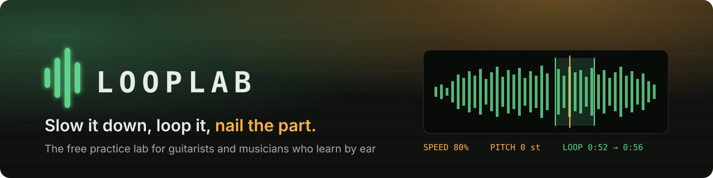
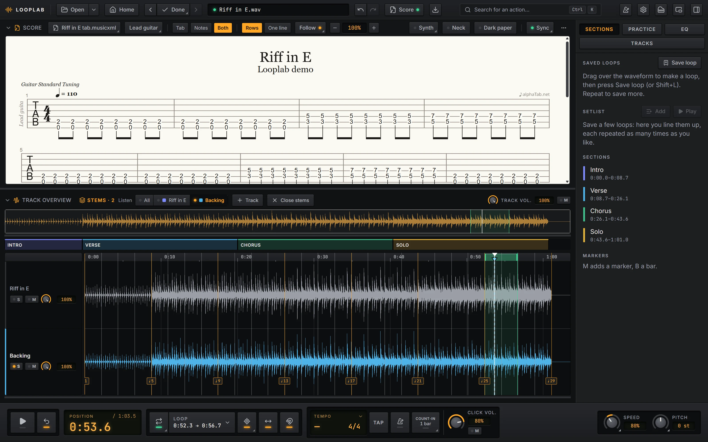
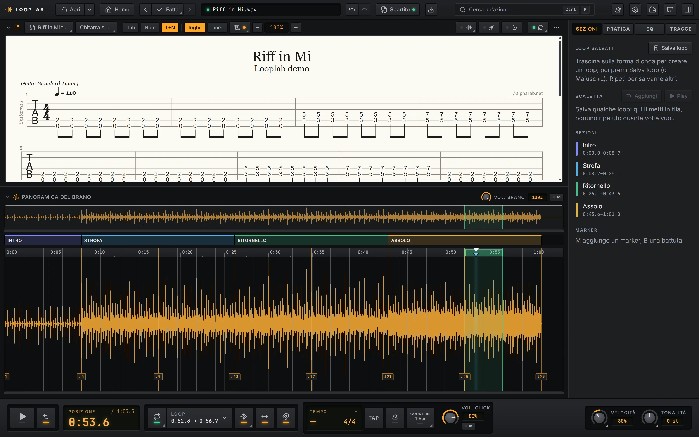
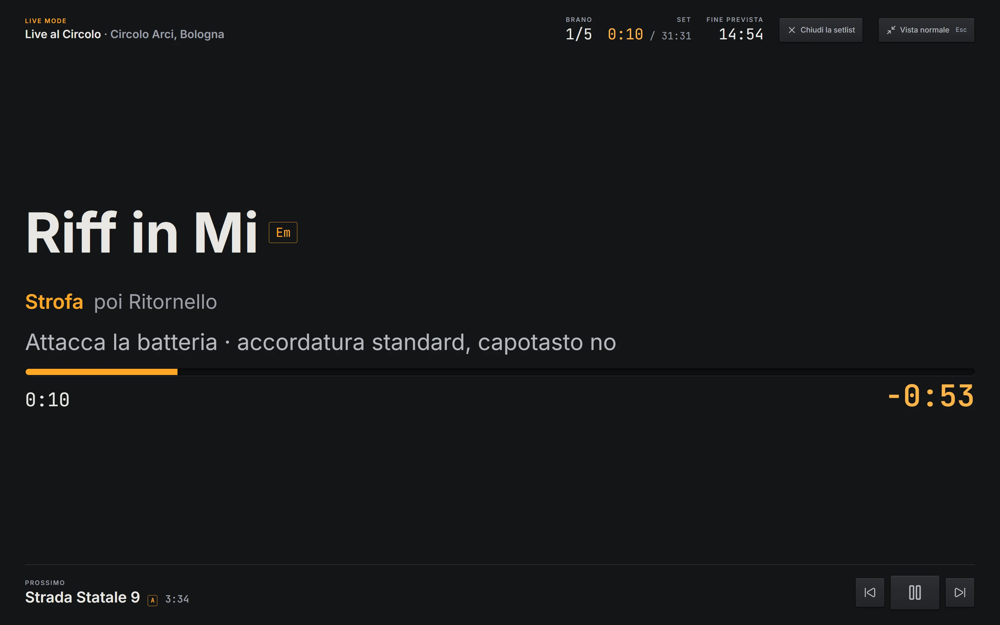
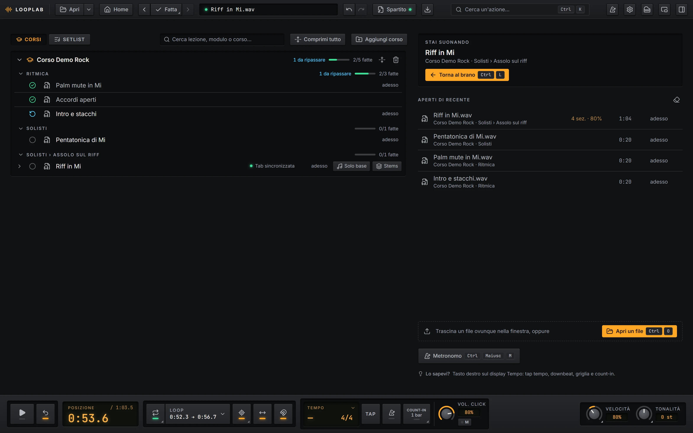
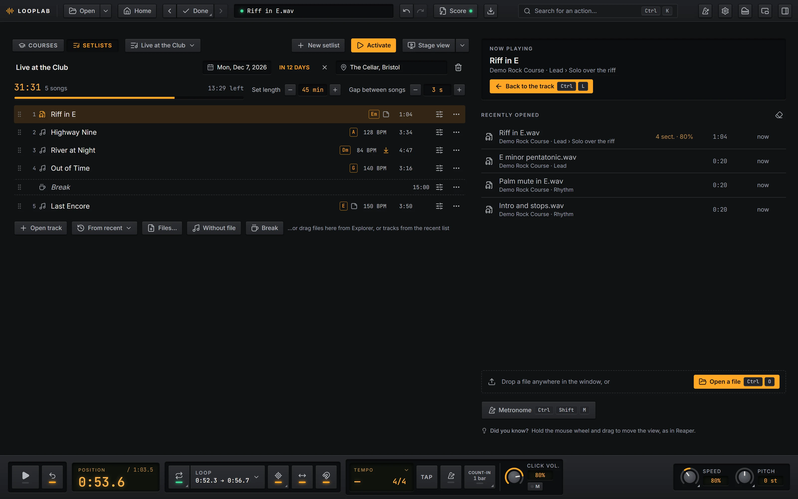

  

  <a href="https://thenexbit.github.io/looplab/"><b>Sito</b></a> ·
  <a href="https://github.com/TheNexBit/looplab/releases/latest"><b>Scarica</b></a> ·
  <a href="#funzioni"><b>Funzioni</b></a> ·
  <a href="#immagini"><b>Immagini</b></a> ·
  <a href="https://ko-fi.com/roxfod"><b>Sostieni</b></a> ·
  <a href="README.md">English</a>

  
  
  
  
  

**Looplab** è l'app desktop per studiare i brani a orecchio. Metti in loop qualsiasi passaggio al
millisecondo, rallenta senza cambiare l'intonazione, segui la tab mentre la musica suona, metti il solo e
la sua base su corsie separate e porta la tua setlist sul palco. Tutto gira sul tuo PC: niente account,
niente abbonamenti, niente internet.

  

## Funzioni

|     |     |
| --- | --- |
| 🔁 **Loop precisi** | Trascina sulla forma d'onda, aggiungi un attacco e una pausa tra le ripetizioni. Salva i loop e mettili in fila. |
| 🎚️ **Velocità e tonalità** | Velocità 25–200% senza cambiare l'intonazione, ±12 semitoni senza cambiare il tempo, e lo speed trainer che accelera da solo. |
| 🎼 **Tab sincronizzate** | Guitar Pro, MusicXML o PDF accanto al brano: la battuta che suona si accende, un clic sulla tab sposta la musica. |
| 🎸 **Solo e base come stems** | Apri più file come corsie, allineate dal suono. «Ascolta» passa dall'una all'altra mentre suona; S, M e volume su ogni corsia. |
| 🥁 **Tracce separate** | Separa voce, chitarra, basso, batteria e piano da qualsiasi brano, elaborato sul tuo PC. |
| 🎤 **Setlist e Live mode** | Prepara la scaletta del concerto, prova i cambi e suona il set sulla Stage view a tutto schermo, anche con il pedale voltapagina. |
| 🎓 **I tuoi corsi in un posto** | Aggiungi la cartella di un corso: ogni lezione si apre pronta con video, inquadrature, base e tab. Segna cosa hai fatto e cosa ripassare. |
| ⏱️ **Metronomo serio** | Click che segue la mappa del tempo del brano, count-in, suddivisioni, accenti ed esercizi ritmici. |
| 🔒 **Tutto resta tuo** | Loop, marker e appunti stanno in una libreria locale con backup automatici. |

Pensato come un DAW: tasti con la spia, manopole, scorciatoie e pedali MIDI. Niente da digitare mentre suoni.

## Immagini

<table>
  <tr>
    <td width="50%"> <b>Studio del passaggio</b> — tab, sezioni e loop all'80%</td>
    <td width="50%"> <b>Sul palco</b> — Live mode, leggibile da lontano</td>
  </tr>
  <tr>
    <td width="50%"> <b>I tuoi corsi</b> — moduli, lezioni fatte e da ripassare</td>
    <td width="50%"> <b>Setlist</b> — data, locale, durate, pause e note</td>
  </tr>
</table>

## Scarica

Prendi l'ultima versione dalla **[pagina delle Release](https://github.com/TheNexBit/looplab/releases/latest)**:

- **Installazione** — con gli aggiornamenti automatici.
- **Portatile** — uno ZIP da tenere in una cartella o su una chiavetta.

Requisiti: Windows 10 o 11, 64 bit.
Audio: mp3, wav, flac, m4a, aac, ogg, aiff · Video: mp4, mov, mkv, webm.

## Sostieni Looplab

Looplab è gratuito e resterà gratuito: niente pubblicità, niente abbonamenti, niente funzioni bloccate.
Se ti fa risparmiare ore di studio, puoi **[offrirmi un caffè su Ko-fi](https://ko-fi.com/roxfod)**:
paga il tempo per le nuove funzioni e la firma del programma.

  

## Compilare dal codice

Le istruzioni per sviluppatori sono nel [README inglese](README.md#build-from-source); la documentazione
tecnica è in italiano: [architettura](docs/ARCHITECTURE.md) · [roadmap](docs/ROADMAP.md) ·
[specifica](docs/SPEC.md) · [licenze di terze parti](docs/THIRD_PARTY_LICENSES.md).

## Crediti

Looplab usa, tra gli altri, [alphaTab](https://alphatab.net/), [pdf.js](https://mozilla.github.io/pdf.js/) e
[FFmpeg](https://ffmpeg.org/) (build LGPL). Elenco completo in [THIRD_PARTY_LICENSES.md](docs/THIRD_PARTY_LICENSES.md).

Fatto da un musicista, per musicisti.

