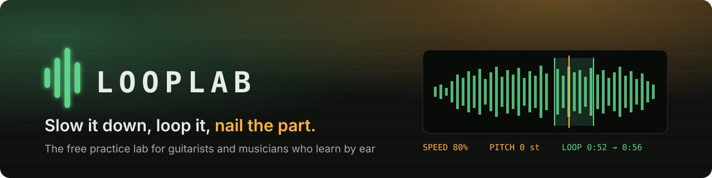
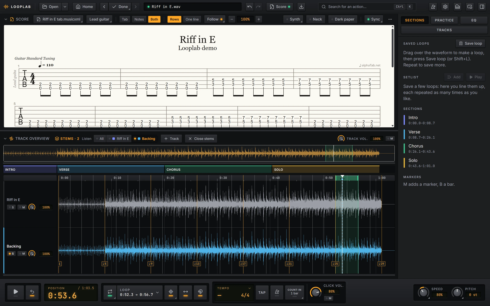
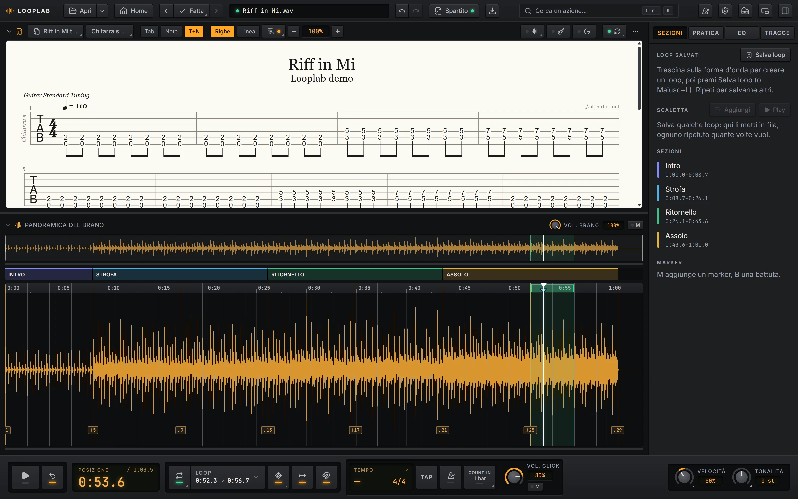
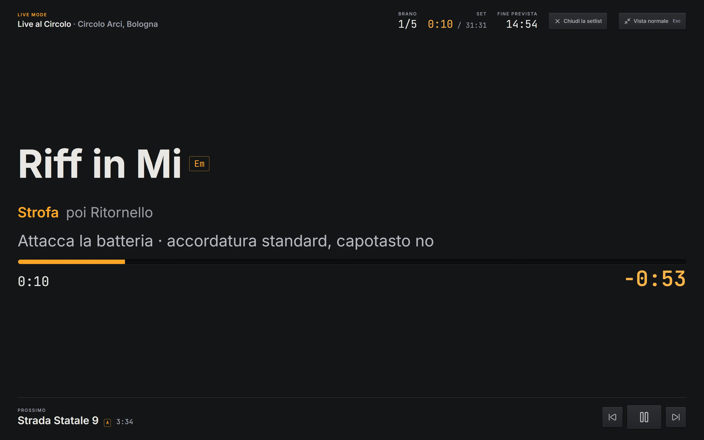
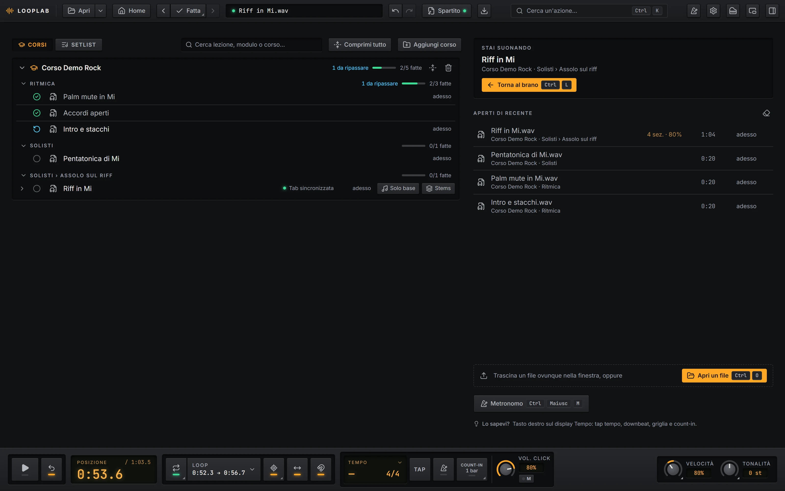
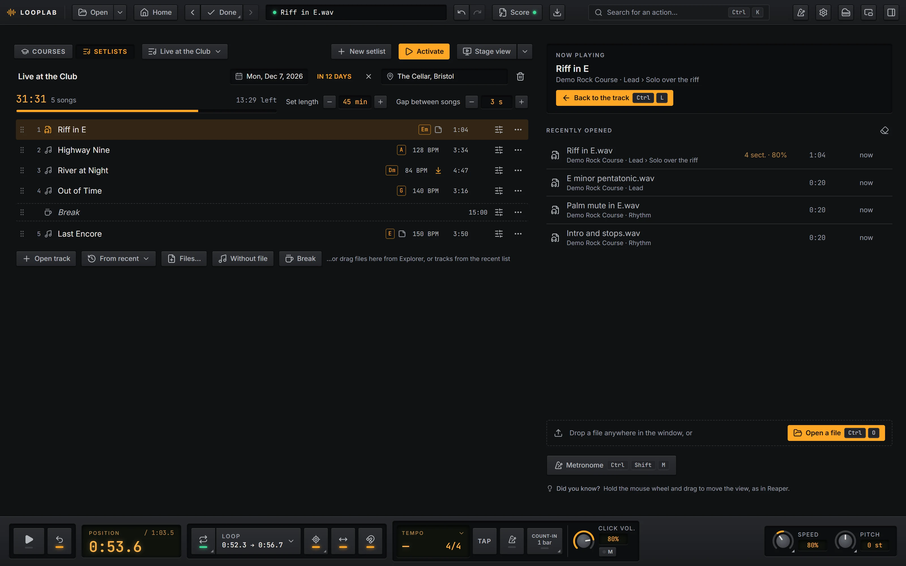

<p align="center">
  
</p>

<p align="center">
  <a href="https://thenexbit.github.io/looplab/"><b>Website</b></a> ·
  <a href="https://github.com/TheNexBit/looplab/releases/latest"><b>Download</b></a> ·
  <a href="#features"><b>Features</b></a> ·
  <a href="#screenshots"><b>Screenshots</b></a> ·
  <a href="https://ko-fi.com/roxfod"><b>Support</b></a> ·
  <a href="README.it.md">Italiano</a>
</p>

<p align="center">
  
  
  
  
  <a href="https://ko-fi.com/roxfod"></a>
</p>

**Looplab** is a desktop practice app for learning songs by ear. Loop any passage to the millisecond,
slow it down without changing the pitch, follow the tab as the music plays, put the solo and its
backing track on separate lanes, and take your setlist on stage. Everything runs on your PC: no
account, no subscription, no internet needed.

<p align="center">
  <a href="site/shots/03-stems.webp"></a>
</p>

## Features

|                                  |                                                                                                                                        |
| -------------------------------- | -------------------------------------------------------------------------------------------------------------------------------------- |
| 🔁 **Precise loops**             | Drag across the waveform, add a lead-in and a gap between repeats. Save loops and chain them.                                          |
| 🎚️ **Speed and pitch**           | 25–200% speed without changing the pitch, ±12 semitones without changing the tempo, plus a speed trainer that speeds up for you.       |
| 🎼 **Synced tabs**               | Guitar Pro, MusicXML or PDF next to the song: the playing bar lights up, a click on the tab moves the music.                           |
| 🎸 **Solo and backing as stems** | Open several files as lanes, lined up by their sound. «Listen» switches between them while it plays; S, M and volume on every lane.    |
| 🥁 **Stem separation**           | Split vocals, guitar, bass, drums and piano out of any song, processed locally on your PC.                                             |
| 🎤 **Setlist & Live mode**       | Build the set for your gig, rehearse the changeovers, then play it on a full-screen Stage view, page-turner pedal included.            |
| 🎓 **Your courses in one place** | Add a course folder: every lesson opens ready, with video, camera angles, backing track and tab. Track what's done and what to review. |
| ⏱️ **A serious metronome**       | A click that follows the song's tempo map, count-in, subdivisions, accents and rhythm drills.                                          |
| 🔒 **Everything stays yours**    | Loops, markers and notes live in a local library with automatic backups.                                                               |

Built like a DAW: lit buttons, knobs, keyboard shortcuts and MIDI pedals, nothing to type while you play.

## Screenshots

<table>
  <tr>
    <td width="50%"><a href="site/shots/01-studio.webp"></a><br><b>Practise the passage</b> — tab, sections and a loop at 80%</td>
    <td width="50%"><a href="site/shots/06-stage.webp"></a><br><b>On stage</b> — Live mode, readable from across the room</td>
  </tr>
  <tr>
    <td width="50%"><a href="site/shots/04-home.webp"></a><br><b>Your courses</b> — modules, lessons done and to review</td>
    <td width="50%"><a href="site/shots/05-setlist.webp"></a><br><b>Setlist</b> — date, venue, lengths, breaks and notes</td>
  </tr>
</table>

> [!NOTE]
> The interface is in English and Italian: it starts in your Windows language and you can switch any time in
> Settings → General.

## Download

Get the latest version from the **[Releases page](https://github.com/TheNexBit/looplab/releases/latest)**:

- **Installer** — with automatic updates.
- **Portable** — a ZIP to keep in a folder or on a USB stick.

Requirements: Windows 10 or 11, 64-bit.
Audio: mp3, wav, flac, m4a, aac, ogg, aiff · Video: mp4, mov, mkv, webm.

## Support Looplab

Looplab is free and will stay free: no ads, no subscriptions, no locked features.
If it saves you hours of practice, you can **[buy me a coffee on Ko-fi](https://ko-fi.com/roxfod)**:
it pays for the time behind new features and for signing the program.

<p>
  <a href="https://ko-fi.com/roxfod"></a>
</p>

## Build from source

<details>
<summary>For developers</summary>

**Stack:** Tauri 2 · React 19 · TypeScript · Zustand · Tailwind v4 · a Rust audio engine.

**Requirements:** Rust (version in `rust-toolchain.toml`), Node (version in `.node-version`),
Visual Studio Build Tools with C++.

```powershell
npm ci
npm run app
```

The launchers in `scripts\` (double-click) wrap the common tasks; the logic lives in `scripts\powershell\`:

| Script                 | What it does                                                        |
| ---------------------- | ------------------------------------------------------------------- |
| `01-dev.cmd`           | runs the app in development                                         |
| `02-test.cmd`          | every check: Biome, TypeScript, Vitest, rustfmt, Clippy, cargo test |
| `03-prova-build.cmd`   | release build, opened with trial data                               |
| `04-build.cmd`         | official build: signed NSIS installer, `latest.json`, portable ZIP  |
| `05-fetch-ffmpeg.cmd`  | downloads the LGPL build of FFmpeg (once)                           |
| `06-genera-chiave.cmd` | creates the update-signing key (once)                               |
| `07-pulisci.cmd`       | deletes `dist` and the development and trial data                   |
| `08-portable.cmd`      | portable ZIP only                                                   |

From a terminal: `npm run app`, `npm run lint`, `npm test`, `npm run test:rust`, `npm run bindings`.

Docs (in Italian): [architecture](docs/ARCHITECTURE.md) · [roadmap](docs/ROADMAP.md) ·
[specification](docs/SPEC.md) · [third-party licences](docs/THIRD_PARTY_LICENSES.md).

</details>

## Contributing

Contributions are welcome: bug reports, ideas, translations and code. Start with
[CONTRIBUTING.md](CONTRIBUTING.md), look for issues labelled
[`good first issue`](https://github.com/TheNexBit/looplab/labels/good%20first%20issue), or say hello in
[Discussions](https://github.com/TheNexBit/looplab/discussions).

## License

Looplab is free software, released under the [GNU General Public License v3.0 or later](LICENSE):
you can use, study, share and change it, and any version you distribute stays free too.

## Credits

Looplab uses [alphaTab](https://alphatab.net/), [pdf.js](https://mozilla.github.io/pdf.js/) and
[FFmpeg](https://ffmpeg.org/) (LGPL build), among others. Full list in
[THIRD_PARTY_LICENSES.md](docs/THIRD_PARTY_LICENSES.md).

<p align="center"><sub>Made by a musician, for musicians.</sub></p>
